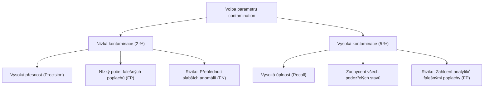

# Průvodce cvičením: Detekce anomálií pomocí Local Outlier Factor (LOF)

Tento dokument detailně rozebírá praktické cvičení zaměřené na detekci odlehlých pozorování (anomálií) v syntetickém shlukovém datasetu `blobs_dataset.csv` pomocí algoritmu **Local Outlier Factor (LOF)**. Speciální důraz je kladen na porovnání citlivosti modelu při předpokladu **2 %** vs. **5 %** kontaminace dat.

---

## 1. Zadání cvičení a kontext

### Formulace úlohy
1. Načíst dataset `blobs_dataset.csv` do prostředí (Pandas / Google Colab / lokální Jupyter).
2. Importovat potřebné metody z knihoven `pandas` a `scikit-learn`.
3. Vytvořit DataFrame a provést standardizaci příznaků (`StandardScaler`).
4. Použít třídu `LocalOutlierFactor` s předpokladem, že anomálie tvoří **2 %** všech pozorování (`contamination=0.02`). Zvolit vhodný počet sousedů $k$ (`n_neighbors=20`).
5. Vygenerovat grafické znázornění, které vizuálně odliší běžná pozorování (inliers) od anomálií (outliers).
6. Zjistit a analyzovat, jak se graf a klasifikace změní, pokud předpokládáme podíl anomálií **5 %** (`contamination=0.05`).

---

## 2. Architektura dat: `blobs_dataset.csv`

Dataset se skládá z **1 000 pozorování** a **2 spojitých příznaků** (`feature_1`, `feature_2`):
- Data reprezentují vícerozměrné shluky (blobs) s nerovnoměrnou hustotou a několika izolovanými body rozptýlenými v prostoru mimo jádra shluků.
- **Proč je LOF ideální volbou?** Standardní globální metody (např. Z-skóre, Mahalanobisova vzdálenost nebo prosté $k$-NN podle eukleidovské vzdálenosti od těžiště) selhávají, pokud mají jednotlivé shluky odlišnou hustotu nebo rozptyl. LOF hodnotí anomálnost **lokálně** vůči hustotě bezprostředního okolí.

---

## 3. Matematické principy algoritmu LOF

Algoritmus Local Outlier Factor (Breunig et al., 2000) porovnává lokální hustotu bodu $p$ s lokálními hustotami jeho $k$ nejbližších sousedů.

### Krok 1: $k$-vzdálenost a $k$-okolí
Pro bod $p$ je $k$-vzdálenost $d_k(p)$ vzdálenost k jeho $k$-tému nejbližšímu sousedovi. $k$-okolí $N_k(p)$ obsahuje všechny body, jejichž vzdálenost od $p$ nepřesahuje $d_k(p)$.

### Krok 2: Dosažitelná vzdálenost (Reachability Distance)
Dosažitelná vzdálenost bodu $p$ od bodu $o$ brání nestabilitám v hustých oblastech:
$$\text{reach-dist}_k(p, o) = \max \big( d_k(o), d(p, o) \big)$$

### Krok 3: Lokální dosažitelná hustota (Local Reachability Density - lrd)
Převrácená hodnota průměrné dosažitelné vzdálenosti bodu $p$ od jeho sousedů:
$$\text{lrd}_k(p) = \frac{|N_k(p)|}{\sum_{o \in N_k(p)} \text{reach-dist}_k(p, o)}$$

### Krok 4: Skóre Local Outlier Factor (LOF)
Poměr průměrné hustoty sousedů k vlastní hustotě bodu $p$:
$$\text{LOF}_k(p) = \frac{\sum_{o \in N_k(p)} \frac{\text{lrd}_k(o)}{\text{lrd}_k(p)}}{|N_k(p)|} = \frac{\frac{1}{|N_k(p)|} \sum_{o \in N_k(p)} \text{lrd}_k(o)}{\text{lrd}_k(p)}$$

### Interpretace skóre LOF:
- **$\text{LOF} \approx 1$**: Bod má srovnatelnou hustotu jako jeho sousedé $\rightarrow$ **Inlier (běžný bod uvnitř shluku)**.
- **$\text{LOF} < 1$**: Bod se nachází v ještě hustší oblasti než jeho sousedé (např. v samém jádru shluku) $\rightarrow$ **Inlier**.
- **$\text{LOF} > 1$**: Bod má nižší hustotu než jeho sousedé.
- **$\text{LOF} \ge 1.5 - 2.0$**: Bod je výrazně izolovanější než jeho okolí $\rightarrow$ **Outlier (anomálie)**.

---

## 4. Výběr hyperparametrů ($k$ a kontaminace)

### 1. Počet sousedů $k$ (`n_neighbors=20`)
- Obecné pravidlo: $k$ by mělo být větší než minimální počet bodů, které tvoří "smysluplný lokální shluk" (obvykle $10 \le k \le 20$), ale menší než celkový počet bodů v nejmenším legitimním shluku.
- Pro 1 000 pozorování je hodnota **$k = 20$** robustním kompromisem – odfiltruje náhodný šum a zároveň zachová citlivost na lokální shlukovou strukturu.

### 2. Parametr kontaminace (`contamination`)
V Scikit-learn parametr `contamination` definuje očekávaný podíl anomálií v trénovacím datasetu:
$$\text{offset} = \text{percentil}( \text{negative\_outlier\_factor\_}, 100 \times \text{contamination} )$$
Bod je označen jako anomálie (výstup `-1`), pokud platí:
$$\text{negative\_outlier\_factor\_} < \text{offset} \iff \text{LOF} > -\text{offset}$$

---

## 5. Porovnání experimentů: 2 % vs. 5 % kontaminace

Na datasetu `blobs_dataset.csv` (1 000 bodů, $k=20$) dosahujeme následujících empirických výsledků:

| Metrika / Vlastnost | Model A: Contamination = 0.02 (2 %) | Model B: Contamination = 0.05 (5 %) | Rozdíl / Posun |
| :--- | :--- | :--- | :--- |
| **Počet anomálií (Outliers)** | **20 bodů** | **50 bodů** | **+30 bodů (+150 %)** |
| **Počet běžných bodů (Inliers)** | 980 bodů | 950 bodů | -30 bodů |
| **Práh LOF ($-\text{offset}$)** | **$\approx 1.730$** | **$\approx 1.504$** | Práh klesl o **0.226** |
| **Minimální LOF v datasetu** | 0.957 (jádro shluku) | 0.957 (jádro shluku) | Beze změny |
| **Průměrné LOF v datasetu** | 1.054 | 1.054 | Skóre bodů se nemění! |
| **Maximální LOF v datasetu** | 4.887 (extrémní izolovaný bod) | 4.887 (extrémní izolovaný bod) | Beze změny |

### Zásadní metodický poznatek:
> **Samotná skóre LOF jednotlivých bodů se změnou `contamination` vůbec nemění!**  
> Mění se pouze **rozhodovací práh (`offset`)**, kterým Scikit-learn dělí body na `+1` (inlier) a `-1` (outlier).
> 
> Všech 20 bodů označených jako anomálie při 2% kontaminaci tvoří **striktní podmnožinu** 50 bodů označených při 5% kontaminaci.

---

## 6. Vizuální a strukturální analýza přidaných anomálií

Při zvýšení kontaminace z 2 % na 5 % se do kategorie anomálií dostává dalších **30 bodů**:
1. **Extrémní anomálie (20 bodů, LOF $\ge 1.730$):**
   - Tyto body leží daleko v prázdném prostoru mezi shluky. Mají extrémně nízkou hustotu okolí a představují zřejmé, nezpochybnitelné anomálie (hrubé chyby měření, podvody, poruchy).
2. **Přidané hraniční anomálie (30 bodů, $1.504 \le \text{LOF} < 1.730$):**
   - Tyto body neleží v prázdnotě, ale tvoří **vnější plášť (periferii)** legitimních shluků.
   - Jejich lokální hustota je nižší než hustota jádra shluku, ale nejedná se o izolované body v širém prostoru.
   - Při 5% kontaminaci model začíná "okrajovat" okraje shluků.

---

## 7. Business dopady a kompromis Precision vs. Recall

Při aplikaci v praxi (např. detekce bankovních podvodů, monitoring IoT senzorů nebo kontrola kvality výroby) má volba kontaminace kritický dopad:

### Kdy volit 2 % (Konzervativní přístup):
- **Vysoké náklady na manuální revizi anomálie:** Pokud každé podezření vyžaduje zásah zkušeného vyšetřovatele a vyšetření je drahé.
- **Cíl:** Zastavit jen jednoznačné, očividné excesy bez obtěžování poctivých klientů.

### Kdy volit 5 % (Agresivní / Bezpečnostní přístup):
- **Kritická bezpečnost nebo nulová tolerance k selhání:** Monitorování turbíny v jaderné elektrárně, medicínská diagnostika kritických stavů.
- **Cíl:** Raději prověřit 30 falešných poplachů na periferii, než riskovat přehlédnutí jednoho počínajícího selhání.
