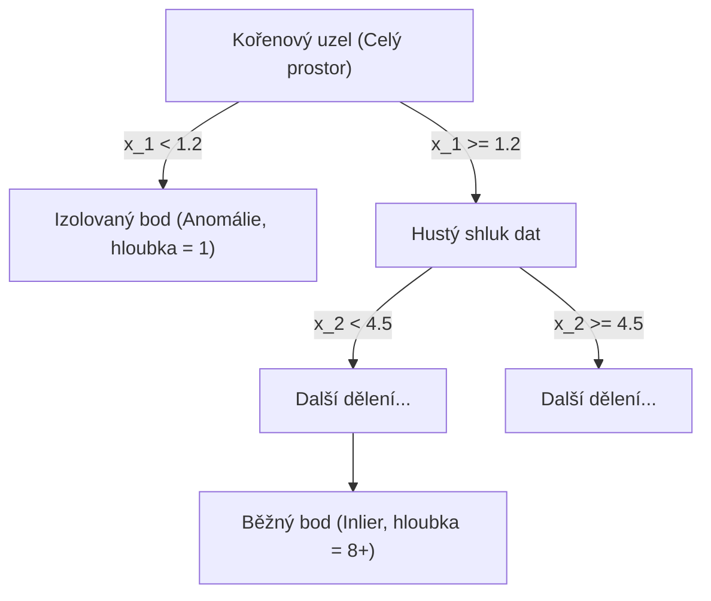

# Teorie & Vzorová implementace: Isolation Forest (iForest)

Tento dokument detailně rozebírá algoritmus **Isolation Forest** (Liu, Ting, Zhou, 2008) na základě přednášky kurzu (*Isolation Forest - sample implementation*) a doplňuje jej o matematické odvození, analýzu složitosti a produkční osvědčené postupy.

---

## 1. Změna paradigmatu: Izolace namísto profilování normality

Většina klasických metod detekce anomálií (např. Gaussovské směsi, Z-skóre, k-NN nebo LOF) funguje na principu **profilování běžných pozorování**:
1. Naučí se model „normálního chování“ (hustotu, těžiště shluků nebo matici vzdáleností).
2. Jakýkoliv bod, který do tohoto profilu nezapadá, prohlásí za anomálii.
3. **Nevýhoda:** Tento přístup je výpočetně drahý ($O(N^2)$ pro hustotní a vzdálenostní metody) a náchylný k přeučení na šumu.

### Klíčová myšlenka Isolation Forest:
Isolation Forest obrací problém naruby: **cíleně a přímo izoluje anomálie** pomocí náhodných stromových řezů. Využívá dvě fundamentální vlastnosti anomálií:
1. **Jsou v menšině:** V datasetu tvoří jen zlomek všech pozorování ($c \ll 1$).
2. **Jsou odlišné v prostoru příznaků:** Nacházejí se v řídce osídlených oblastech s výrazně odlišnými hodnotami atributů.

> **Výsledek:** Anomálie vyžadují dramaticky **méně náhodných řezů** k úplné izolaci než body nacházející se v hustých shlucích.

---

## 2. Jak funguje stromová izolace (Isolation Tree - iTree)?

Pro daný podsoubor dat o velikosti $\psi$ (`max_samples`, standardně $\psi = 256$):
1. Náhodně a rovnoměrně vybereme jeden příznak $q \in \{1, \dots, D\}$.
2. Náhodně a rovnoměrně zvolíme dělící hodnotu (štěpící bod) $p$ mezi minimem a maximem vybraného příznaku v aktuálním uzlu:
   $$p \sim \text{Uniform}(\min(X_q), \max(X_q))$$
3. Data rozdělíme na dvě podmnožiny: body s $x_q < p$ jdou vlevo, body s $x_q \ge p$ jdou vpravo.
4. Rekurzivně pokračujeme, dokud:
   - Uzel neobsahuje právě 1 bod ($|X| = 1$), nebo
   - Všechny body v uzlu nemají identické hodnoty, nebo
   - Hloubka stromu nedosáhne limitu $h_{\max} = \lceil \log_2(\psi) \rceil$.



---

## 3. Matematická formulace skóre anomálií

### 1. Délka cesty $h(x)$
Délka cesty $h(x)$ je počet hran, které bod $x$ projde od kořene stromu k odpovídajícímu listovému uzlu.
- Průměrná délka cesty napříč lesem $T$ stromů:
  $$E(h(x)) = \frac{1}{T} \sum_{t=1}^T h_t(x)$$

### 2. Průměrná délka cesty v binárním vyhledávacím stromu $c(n)$
Struktura stromu iTree je ekvivalentní binárnímu vyhledávacímu stromu (Binary Search Tree - BST). Průměrná délka neúspěšného hledání v BST pro vzorek o velikosti $n$ slouží jako teoretická normalizační konstanta:
$$c(n) = 2 H(n-1) - \frac{2(n-1)}{n} \quad \text{pro } n > 2$$
kde $H(i)$ je $i$-té harmonické číslo, které lze aproximovat pomocí Eulerovy-Mascheroniho konstanty ($\gamma \approx 0.5772156649$):
$$H(i) \approx \ln(i) + \gamma$$
Pro okrajové případy platí:
$$c(2) = 1, \quad c(n \le 1) = 0$$

### 3. Skóre anomálie $s(x, n)$
Normalizované skóre anomálie pro bod $x$ v populaci o velikosti $n$ je definováno vztahem:
$$s(x, n) = 2^{-\frac{E(h(x))}{c(n)}}$$

### Interpretace skóre $s(x, n)$:
- **$E(h(x)) \to 0 \implies s \to 2^0 = 1$:** Bod je izolován téměř okamžitě (velmi mělká hloubka) $\rightarrow$ **Jednoznačná anomálie**.
- **$E(h(x)) \to n-1 \implies s \to 0$:** Bod vyžaduje velké množství dělení $\rightarrow$ **Běžné pozorování (Inlier)**.
- **$E(h(x)) \to c(n) \implies s \to 2^{-1} = 0.5$:** Bod má průměrnou hloubku odpovídající náhodnému rozdělení.
- **Pokud mají všechny body $s \approx 0.5$**, vzorek nevykazuje žádné signifikantní anomálie.

---

## 4. Implementace v Scikit-learn (`sklearn.ensemble.IsolationForest`)

Scikit-learn implementuje třídu `IsolationForest` v modulu `ensemble`.

### Klíčové hyperparametry:
1. `n_estimators` (výchozí: 100): Počet izolačních stromů v lese. Obvykle 100 stromů plně postačuje pro stabilitu průměrné hloubky cesty.
2. `max_samples` (výchozí: `'auto'`, tj. $\min(256, n)$): Počet vzorků pro trénování každého stromu. **Subsampling na 256 vzorků je geniální vlastnost iForest** – dramaticky urychluje výpočet a eliminuje fenomény maskování (masking) a zahlcení (swamping).
3. `contamination` (výchozí: `'auto'`, odpovídá 0.1): Očekávaný podíl anomálií v datech (např. `0.05` pro 5 %).
4. `random_state`: Fixace náhodného generátoru pro reprodukovatelnost.

### Výpočetní metody a rozhodovací funkce:
- `fit_predict(X)`: Vrací diskrétní označení: `+1` pro běžný bod (inlier), `-1` pro anomálii (outlier).
- `decision_function(X)`: Vrací spojité skóre posunuté tak, že:
  - $\text{decision\_function}(x) < 0 \implies \text{Anomálie}$
  - $\text{decision\_function}(x) \ge 0 \implies \text{Běžné pozorování}$
- `score_samples(X)`: Vrací záporné skóre anomálie odpovídající Liu et al. (2008).

```python
from sklearn.ensemble import IsolationForest

# Inicializace modelu
iso_forest = IsolationForest(
    n_estimators=100,
    contamination=0.05,
    random_state=42
)

# Trénování a predikce
preds = iso_forest.fit_predict(X)
decision_scores = iso_forest.decision_function(X)
```

---

## 5. Výhody a nevýhody algoritmu (dle slajdů 21–22)

### Výhody (Advantages):
1. **Výpočetní efektivita:** Časová složitost je $O(t \cdot \psi \log \psi)$, kde $t$ je počet stromů a $\psi$ je velikost podvzorku (typicky 256). Je lineární vůči počtu atributů a nezávisí kvadraticky na celkovém počtu řádků $N$.
2. **Škálovatelnost pro velké datasety:** Vynikající pro masivní datasety ($N > 1\,000\,000$), kde metody založené na vzdálenostech (k-NN, LOF) zkolabují na nedostatku paměti.
3. **Nevyžaduje normalizaci ani standardizaci:** Stromové řezy jsou invariantní vůči monotónním transformacím. Rozsahy příznaků nemusí být škálovány (`StandardScaler` není striktně nutný, i když neškodí).
4. **Odolnost vůči nepodstatným příznakům:** Díky náhodnému výběru atributů dokáže fungovat i při existenci šumových proměnných.

### Nevýhody (Disadvantages):
1. **Náhodnost (Stochastický charakter):** Jelikož výběr dělících os i hodnot je náhodný, dva běhy bez zafixovaného `random_state` mohou vrátit mírně odlišné anomálie na hraničních bodech.
2. **Problém se shluky anomálií (Clustered Anomalies / Masking):** Pokud se skupina anomálií shlukne do vlastního hustého hloučku, náhodné řezy je nemusí snadno izolovat, protože vyžadují mnoho dělení.
3. **Axiální artefakty (Axis-Aligned Splitting):** Řezy probíhají pouze rovnoběžně se souřadnicovými osami. Pro šikmé nebo nelineární geometrie to může vytvářet „fantomové“ zóny anomálií (řešením je *Extended Isolation Forest*, který používá náhodné nadroviny pod libovolnými úhly).
