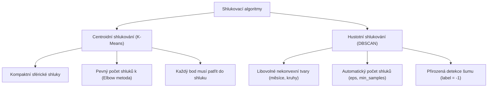

# Den 5: Velká syntéza neřízeného učení (Unsupervised Learning)

Tento dokument představuje ucelené shrnutí a závěrečnou syntézu **5. dne kurzu Machine Learning**, který byl věnován **neřízenému učení (Unsupervised Learning)**. Dokument vychází ze závěrečné prezentace kurzu (*Day_5_summary.pdf*) a propojuje teorii redukce dimenzionality, shlukování a detekce anomálií do jednotného metodického rámce.

---

## 1. Základní paradigma: Řízené vs. Neřízené učení

| Vlastnost | Řízené učení (Supervised Learning) | Neřízené učení (Unsupervised Learning) |
| :--- | :--- | :--- |
| **Vstupní data** | Matice příznaků $\mathbf{X}$ + cílový vektor $\mathbf{y}$ (labely) | Pouze matice příznaků $\mathbf{X}$ (bez labelů) |
| **Cíl modelu** | Predikce čísla (regrese) nebo kategorie (klasifikace) | Hledání skrytých struktur, shluků, projekcí a extrémů |
| **Evaluace** | Jednoznačná (RMSE, $R^2$, Accuracy, F1, ROC-AUC) | Subjektivní & interní metriky (Silhouette, Inertia, Explained Variance) |
| **Riziko přetrénování** | Přímo měřitelné na testovací sadě | Obtížně definovatelné (model může najít náhodné shluky v šumu) |

---

## 2. Pilíř I: Redukce dimenzionality (Dimensionality Reduction)

Redukce dimenzionality transformuje vysokodimenzionální prostor $\mathbb{R}^D$ do nižšího prostoru $\mathbb{R}^d$ ($d \ll D$) s minimální ztrátou informace.

### Hlavní důvody pro redukci:
1. **Překonání prokletí dimenzionality (Curse of Dimensionality):** Ve vysokých dimenzích jsou všechny body stejně daleko od sebe, což paralyzuje k-NN, LOF i gradientní metody.
2. **Eliminace multikolinearity:** Redukuje provázané atributy do vzájemně nekorelovaných komponent.
3. **Vizuální explorace:** Lidské vnímání je omezeno na 2D a 3D grafy.
4. **Výpočetní komprese:** Zrychlení trénování následných modelů a úspora paměti.

### Přehled metod probíraných a zmíněných v kurzu:
- **PCA (Principal Component Analysis):** Lineární ortogonální transformace maximalizující rozptyl projekce. Vynikající pro spojitá tabulková data s lineárními vazbami.
- **t-SNE (t-Distributed Stochastic Neighbor Embedding):** Nelineární pravděpodobnostní metoda. Zachovává lokální sousedství bodů; ideální pro 2D vizualizaci složitých nelineárních manifoldů.
- **LDA (Linear Discriminant Analysis):** Využívá třídy k maximalizaci separace mezi skupinami (často využíváno v NLP a klasifikaci).

---

## 3. Pilíř II: Shluková analýza (Clustering)

Cílem shlukování je rozdělit pozorování do přirozených skupin (klastrů) tak, aby body uvnitř stejného shluku byly maximálně podobné a body v různých shlucích maximálně odlišné.

### Dvě fundamentální rodiny algoritmů:

### Typické byznysové aplikace shlukování:
- **Zákaznická segmentace (RFM / Demografie):** Identifikace VIP klientů, lovců slev či pasivních uživatelů.
- **Seskupování textových dokumentů (Topic Modeling / News clustering):** Automatické třídění článků dle témat.
- **Analýza medicínských obrazů:** Segmentace tkání na ultrazvuku či MRI.

---

## 4. Pilíř III: Detekce anomálií (Anomaly Detection)

Detekce anomálií identifikuje vzácná, neobvyklá nebo podezřelá pozorování, která se zásadně odchylují od většinové distribuce dat.

### Dva klíčové přístupy kurzu:

1. **Isolation Forest (iForest):**
   - *Princip:* Přímá stromová izolace vzácných bodů.
   - *Matematika:* Anomálie vyžadují mělkou hloubku $E(h(x)) \ll c(n) \implies s(x, n) \to 1.0$.
   - *Silná stránka:* Lineární složitost $O(t \cdot \psi \log \psi)$, škáluje na miliony řádků, nepotřebuje standardizaci.
2. **Local Outlier Factor (LOF):**
   - *Princip:* Poměr lokální dosažitelné hustoty ($\text{lrd}$) bodu k hustotám jeho $k$ nejbližších sousedů.
   - *Matematika:* $\text{LOF} > 1.5 \implies$ bod je izolovanější než jeho okolí.
   - *Silná stránka:* Exceluje u shluků s proměnlivou hustotou (kde iForest selhává).

### Dvě role detekce anomálií v produkci:
- **Samostatný produkt / služba:** Detekce platebních podvodů (Fraud Detection), monitoring kybernetických útoků v síti, prediktivní údržba ložisek a turbín.
- **Předzpracování pro řízené učení:** Odstranění chyb měření a toxických odlehlých bodů, které by zkreslily regresní přímku nebo rozhodovací strom.

---

## 5. Velká srovnávací matice algoritmů Dne 5

| Algoritmus | Paradigma | Výpočetní složitost | Nutnost škálování | Klíčové hyperparametry | Kdy nasadit? |
| :--- | :--- | :--- | :--- | :--- | :--- |
| **PCA** | Redukce dimenzionality | $O(\min(N^3, D^3))$ | ✅ **Kriticky nutné** | `n_components` | Multikolinearita, komprese, 2D vizualizace |
| **K-Means** | Centroidní shlukování | $O(N \cdot k \cdot I \cdot D)$ | ✅ **Kriticky nutné** | `n_clusters`, `n_init` | Rychlá segmentace konvexních sférických shluků |
| **DBSCAN** | Hustotní shlukování | $O(N \log N)$ až $O(N^2)$ | ✅ **Kriticky nutné** | `eps`, `min_samples` | Nekonvexní tvary, přítomnost šumu a outlierů |
| **LOF** | Lokální hustota | $O(N^2 \cdot D)$ | ✅ **Kriticky nutné** | `n_neighbors`, `contamination` | Shluky s proměnlivou hustotou, $N < 50\,000$ |
| **Isolation Forest** | Stromová izolace | $O(t \cdot \psi \log \psi)$ | ❌ **Není nutné** | `n_estimators`, `contamination` | Masivní data ($N > 100\,000$), vysoké dimenze |

---

## 6. Závěrečné desatero neřízeného učení (Best Practices 2026)

1. **Vždy zkontrolujte škály proměnných:** K-Means, DBSCAN, PCA i LOF závisejí na eukleidovské vzdálenosti – bez `StandardScaler` bude veličina v tisících zcela dominovat.
2. **Pozor na parametr `contamination`:** Skóre anomálie bodů se nemění; kontaminace pouze nastavuje percentilový řez.
3. **Elbow metoda není exaktní věda:** Kombinujte koleno WCSS vždy s metrikou Silhouette skóre nebo Davies-Bouldin indexem.
4. **DBSCAN netoleruje globální eps při různé hustotě:** Pokud mají shluky různou hustotu, DBSCAN buď shluky sloučí, nebo řídký prohlásí za šum (zvažte HDBSCAN).
5. **Nepoužívejte PCA slepě pro nelineární data:** Pokud jsou vazby nelineární (např. soustředné kruhy), PCA rozptyl nezachytí – sáhněte po Kernel PCA nebo t-SNE.
6. **Subsampling v Isolation Forest je klíčový:** Ponechte `max_samples=256`. Větší vzorek zhoršuje detekci kvůli fenoménům *swamping* a *masking*.
7. **LOF je transductivní:** Pro skórování nových příchozích dat v reálném čase musíte explicitně nastavit `novelty=True`.
8. **Neřízené učení je skvělý feature engineer:** Vzdálenosti k centroidům K-Means nebo skóre z iForest mohou sloužit jako nové prediktory pro XGBoost či neuronové sítě.
9. **Pozor na axiální artefakty iForest:** U šikmých korelací generuje pravoúhlé zóny anomálií (řešením je *Extended Isolation Forest*).
10. **Etika a vysvětlitelnost (XAI):** V sociálních a medicínských aplikacích nesmí být štítek anomálie černou skříňkou – doplňte jej o SHAP hodnoty nebo konkrétní odchylky od průměru.
