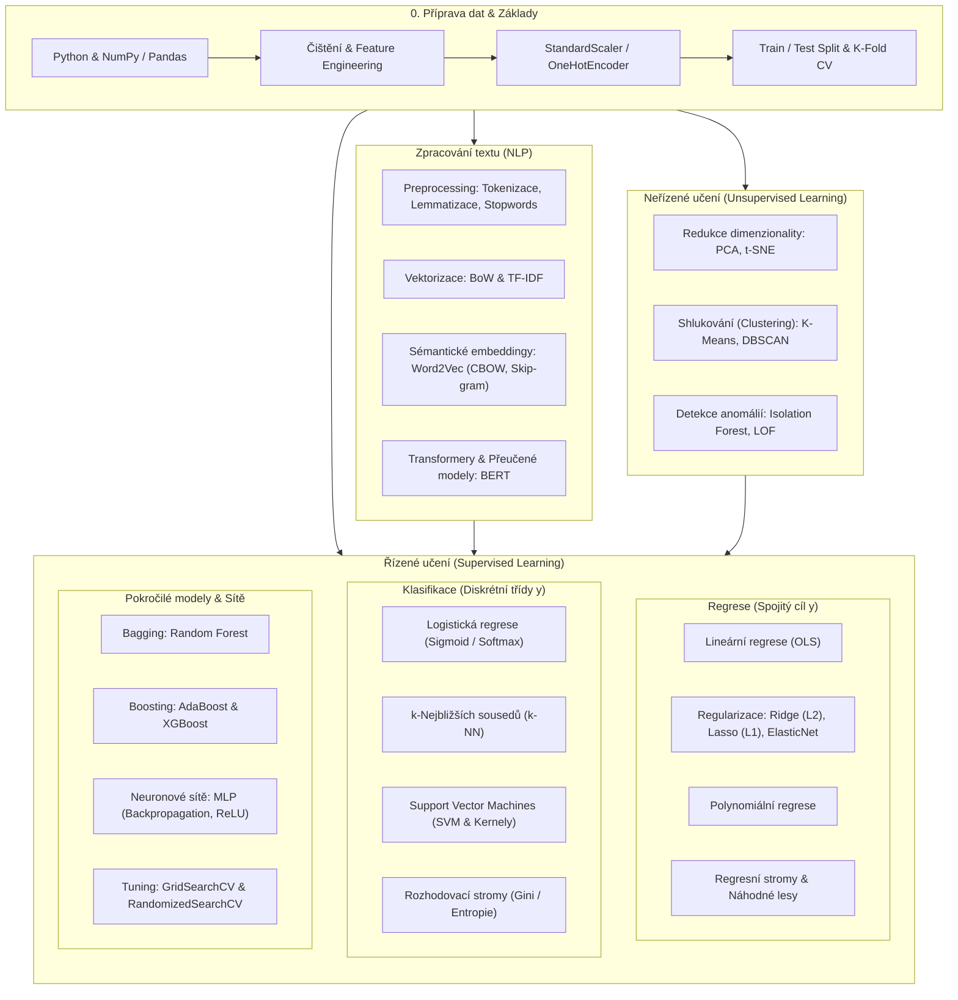

# Velké shrnutí kurzu: Machine Learning (Prework až Den 5)

Tento dokument představuje **kompletní syntézu a retrospektivu** celého kurzu Data Science / Machine Learning. Pokrývá systematický přehled všech probraných paradigmat, algoritmů, matematických základů, metrik a praktických doporučení pro volbu správného modelu.

---

## 🗺️ 1. Celkový přehled cesty strojovým učením

Během kurzu jsme prošli od základní manipulace s daty přes klasické modely až po moderní hluboké neuronové sítě, zpracování textu a neřízené metody.

---

## 📊 2. Rekapitulace modulů krok za krokem

### Modul 0: Prework – Příprava dat a explorace
- **Datové struktury**: `numpy.ndarray` pro optimalizované maticové výpočty, `pandas.DataFrame` pro tabulární operace.
- **Příprava dat**:
  - Detekce a imputace chybějících hodnot (`SimpleImputer`, `mean`/`median`/`most_frequent`).
  - Kódování kategorií (`OneHotEncoder`, `OrdinalEncoder`).
  - Škálování příznaků (`StandardScaler`: $z = \frac{x - \mu}{\sigma}$, `MinMaxScaler`: $x_{norm} = \frac{x - x_{min}}{x_{max} - x_{min}}$).
- **Zlaté pravidlo**: Transformátory fitujeme **pouze na trénovací sadě** (`scaler.fit_transform(X_train)`) a testovací sadu pouze transformujeme (`scaler.transform(X_test)`), abychom předešli úniku dat (**Data Leakage**).

---

### Modul 1: Regrese – Predikce spojitých veličin
Cílem regrese je modelovat vztah mezi vysvětlujícími proměnnými $X$ a spojitou cílovou proměnnou $y \in \mathbb{R}$.

1. **Jednoduchá a vícenásobná lineární regrese**:
   $$\hat{y} = \beta_0 + \beta_1 x_1 + \beta_2 x_2 + \dots + \beta_p x_p$$
   - Optimalizační kritérium: metoda nejmenších čtverců (OLS – Ordinary Least Squares).
2. **Polynomiální regrese**: Modelování nelineárních závislostí pomocí transformace příznaků do vyšších mocnin ($x, x^2, x_1 x_2$).
3. **Regularizace proti přetrénování (Overfitting)**:
   - **Ridge regrese ($L_2$)**: Přidává penalizaci $\lambda \sum \beta_j^2$. Zmenšuje váhy k nule, ale žádnou zcela nevynuluje; ideální při multikolinearitě.
   - **Lasso regrese ($L_1$)**: Přidává penalizaci $\lambda \sum |\beta_j|$. Provádí automatický výběr příznaků (Feature Selection) – některé koeficienty nastaví přesně na 0.
   - **ElasticNet**: Lineární kombinace $L_1$ a $L_2$ regularizace ($\alpha \cdot L_1 + (1-\alpha) \cdot L_2$).
4. **Metriky kvality regrese**:
   - **MSE** (Mean Squared Error): $\frac{1}{n} \sum (y_i - \hat{y}_i)^2$ – silně penalizuje velké chyby.
   - **RMSE** (Root Mean Squared Error): $\sqrt{\text{MSE}}$ – v původních jednotkách cílové proměnné.
   - **MAE** (Mean Absolute Error): $\frac{1}{n} \sum |y_i - \hat{y}_i|$ – robustní vůči odlehlým hodnotám.
   - **$R^2$ skóre** (Koeficient determinace): Procento rozptylu cíle vysvětlené modelem ($1 - \frac{SS_{res}}{SS_{tot}}$).

---

### Modul 2: Klasifikace – Predikce kategoriálních tříd
Cílem je přiřadit pozorování do diskrétní třídy $y \in \{0, 1\}$ (binární) nebo $y \in \{1, \dots, K\}$ (multiclass).

1. **Logistická regrese**:
   - Modeluje aposteriorní pravděpodobnost přes sigmoidální funkci:
     $$P(y=1|X) = \sigma(z) = \frac{1}{1 + e^{-z}}, \quad z = \mathbf{w}^T \mathbf{x} + b$$
   - Ztrátová funkce: Log-Loss (Binary Cross-Entropy).
2. **k-Nejbližších sousedů (k-NN)**:
   - Neparametrický, instanční algoritmus (Lazy learner).
   - Klasifikuje podle většinového hlasování $k$ prostorově nejbližších sousedů (Eukleidovská vzdálenost). Vyžaduje striktní škálování!
3. **Rozhodovací stromy (Decision Trees)**:
   - Hierarchické větvení prostoru pomocí rozhodovacích pravidel.
   - Kritérium dělení: **Gini Impurity** ($1 - \sum p_i^2$) nebo **Entropie / Information Gain** ($-\sum p_i \log_2 p_i$).
   - Náchylné k přetrénování $\rightarrow$ nutný pruning (`max_depth`, `min_samples_leaf`).
4. **Support Vector Machines (SVM)**:
   - Hledá optimální nadrovinu maximalizující okraj (Margin) mezi třídami.
   - **Kernel Trick**: Mapování do vysokodimenzionálního prostoru pro separaci nelineárních dat (lineární, RBF/Gaussovský, polynomiální).
5. **Metriky kvality klasifikace**:
   - **Accuracy**: Celková přesnost ($\frac{TP+TN}{TP+TN+FP+FN}$) – zavádějící u nevyvážených tříd!
   - **Precision**: $\frac{TP}{TP+FP}$ – jak moc si můžeme být jisti, když model řekne „Pozitivní“.
   - **Recall (Senzitivita)**: $\frac{TP}{TP+FN}$ – kolik skutečně pozitivních případů model zachytil.
   - **F1-Score**: Harmonický průměr Precision a Recall ($2 \cdot \frac{P \cdot R}{P + R}$).
   - **ROC-AUC**: Plocha pod ROC křivkou (True Positive Rate vs. False Positive Rate napříč všemi rozhodovacími prahy).

---

### Modul 3: Pokročilé modely – Ensembly & Neuronové sítě

1. **Ensemble metody**:
   - **Bagging (Bootstrap Aggregating)**: Paralelní trénování nezávislých modelů na bootstrap vzorcích s průměrováním/hlasováním. Snižuje **rozptyl (Variance)**. Typický zástupce: **Random Forest**.
   - **Boosting**: Sekvenční trénování slabých modelů, kde každý následující model opravuje chyby předchozích. Snižuje **vychýlení (Bias)** i rozptyl. Typický zástupce: **Gradient Boosting**, **XGBoost** (s $L_1/L_2$ regularizací a paralelizací na úrovni histogramů).
2. **Umělé neuronové sítě (MLP – Multi-Layer Perceptron)**:
   - Architektura: Vstupní vrstva $\rightarrow$ Skryté vrstvy $\rightarrow$ Výstupní vrstva.
   - Aktivační funkce: **ReLU** ($f(x)=\max(0, x)$), **Sigmoid**, **Softmax** (multiclass pravděpodobnosti).
   - Učení: **Forward pass** $\rightarrow$ Výpočet ztráty (Loss) $\rightarrow$ **Backpropagation** (řetízkové pravidlo pro výpočet gradientů $\frac{\partial \mathcal{L}}{\partial w}$) $\rightarrow$ Optimalizátor (**Adam**, **SGD**, **RMSprop**).
3. **Optimalizace hyperparametrů**:
   - **GridSearchCV**: Vyčerpávající prohledání kartézského součinu zadaných hodnot s k-násobnou křížovou validací.
   - **RandomizedSearchCV**: Náhodný výběr $N$ kombinací z pravděpodobnostních distribucí (efektivní pro rozsáhlé hyperparametrické prostory).

---

### Modul 4: Zpracování přirozeného jazyka (NLP)

1. **Předzpracování textu**:
   - Normalizace (lower-casing, odstranění diakritiky, interpunkce a HTML tagů).
   - **Tokenizace**: Rozdělení textu na slova/pod-slova.
   - **Odstranění Stopwords**: Vyřazení balastních slov bez informační hodnoty (spojky, předložky).
   - **Lemmatizace vs. Stemming**: Stemming ořezává konce slov heuristicky; Lemmatizace hledá základní slovníkový tvar (lemma) s ohledem na slovní druh (POS).
2. **Reprezentace textu**:
   - **Bag of Words (BoW / `CountVectorizer`)**: Frekvenční matice výskytu slov. Ignoruje kontext i pořadí.
   - **TF-IDF (`TfidfVectorizer`)**: Vážení frekvence slova v dokumentu (TF) inverzní frekvencí ve všem korpusu (IDF):
     $$\text{TF-IDF}(t, d, D) = \text{TF}(t, d) \times \log\left(\frac{N}{|\{d \in D : t \in d\}|}\right)$$
   - **Word2Vec**: Distribuované sémantické vektorové reprezentace (Embeddings). Slova s podobným významem leží blízko v prostoru ($\text{king} - \text{man} + \text{woman} \approx \text{queen}$). Architektury **CBOW** (predikce slova z kontextu) a **Skip-gram** (predikce kontextu ze slova).
3. **Moderní Transformer architektura & BERT**:
   - Mechanismus pozornosti (**Self-Attention**), obousměrný kontext (Bidirectional Encoder Representations from Transformers). Přenášené učení (**Transfer Learning**) na masivních korpusech.

---

### Modul 5: Neřízené učení (Unsupervised Learning)

Pracuje s neoznačenými daty ($X$ bez $y$). Cílem je objevit vnitřní strukturu, geometrii a anomálie.

1. **Redukce dimenzionality**:
   - **PCA (Principal Component Analysis)**: Lineární ortogonální projekce do směru maximálního rozptylu dat. Slouží ke kompresi, odstranění multikolinearity a 2D/3D vizualizaci.
   - **t-SNE / UMAP**: Nelineární projekce zachovávající lokální sousedství. Excelentní pro explorativní vizualizaci shluků.
2. **Shlukování (Clustering)**:
   - **K-Means**: Dělení prostoru do $K$ shluků minimalizací vnitroshlukové sumy čtverců (Inercie). Předpokládá sférické a stejně velké shluky. Volba $K$: **Elbow method**, **Silhouette Score**.
   - **DBSCAN**: Hustotní shlukování (Density-Based). Nalezne shluky libovolných tvarů, automaticky identifikuje šum/outliery (označeny jako $-1$). Parametry: $\varepsilon$ (poloměr sousedství) a `min_samples`.
3. **Detekce anomálií (Anomaly Detection)**:
   - **Isolation Forest**: Soubor náhodných stromů (iTrees). Izoluje anomálie na malém počtu náhodných řezů (kratší průměrná hloubka $h(x)$). Extrémně rychlý, škáluje na $O(n \log n)$.
   - **Local Outlier Factor (LOF)**: Hustotní metoda založená na k-NN. Srovnává lokální hustotu bodu s hustotou jeho sousedů. Ideální pro data s proměnlivou lokální hustotou.

---

## 🧭 3. Rozhodovací strom: Kdy jaký algoritmus použít?

Následující matice slouží jako rychlý průvodce pro volbu algoritmu v praxi:

| Typ úlohy | Podmínky / Charakteristika dat | Doporučený algoritmus | Alternativy |
| :--- | :--- | :--- | :--- |
| **Regrese** | Malá data, vyžadována interpretovatelnost | **Lineární regrese / Ridge / Lasso** | DecisionTreeRegressor |
| **Regrese** | Tabulární data, nelineární vztahy, špičkový výkon | **XGBoost / LightGBM** | Random Forest Regressor |
| **Regrese** | Vysoce nelineární, složité interakce, velké objemy | **MLP / Hluboké sítě** | GradientBoosting |
| **Klasifikace** | Lineárně separabilní, nutné pravděpodobnosti | **Logistická regrese** | Linear SVM |
| **Klasifikace** | Tabulární data, heterogenní příznaky | **Random Forest / XGBoost** | Extra Trees |
| **Klasifikace** | Nelineární hranice, střední velikost dat ($N < 50k$) | **SVM s RBF jádrem** | k-NN |
| **Klasifikace** | Velká data, obrázky, audio, sekvence | **Neuronové sítě (CNN/RNN/MLP)** | Pre-trained Transformers |
| **NLP** | Rychlá klasifikace témat / spamu | **TF-IDF + Naive Bayes / LogReg** | BoW + LinearSVC |
| **NLP** | Jemné sémantické porozumění, sentiment, Q&A | **Pre-trained BERT / RoBERTa / LLM** | Word2Vec + BiLSTM |
| **Redukce dim.** | Rychlá lineární komprese, potlačení šumu | **PCA** | TruncatedSVD |
| **Redukce dim.** | 2D/3D vizualizace shluků v neznámých datech | **t-SNE / UMAP** | PCA |
| **Shlukování** | Sférické shluky, známé přibližné $K$, velká data | **K-Means / MiniBatchKMeans** | Gaussian Mixtures (GMM) |
| **Shlukování** | Neznámý počet shluků, libovolné tvary, šum | **DBSCAN** | HDBSCAN |
| **Anomálie** | Globální outliery, tabulární vysokodimenzionální data | **Isolation Forest** | One-Class SVM |
| **Anomálie** | Lokální shlukové anomálie, proměnlivá hustota | **Local Outlier Factor (LOF)** | EllipticEnvelope |

---

## ⚠️ 4. Nejčastější úskalí a jak se jim vyhnout (Gotchas)

1. **Data Leakage (Únik dat)**:
   - *Chyba*: Použití `fit_transform` na celém datasetu před rozdělením na trénovací a testovací sadu.
   - *Správně*: Vždy rozdělit na train/test jako první krok. Používat `sklearn.pipeline.Pipeline`, která zaručí oddělené transformace.
2. **Class Imbalance (Nevyvážené třídy)**:
   - *Chyba*: Hodnocení modelu s $99\,\%$ nulových tříd pomocí Accuracy.
   - *Správně*: Používat Precision, Recall, PR-AUC, F1-Score, techniky převzorkování (SMOTE) nebo vážení tříd (`class_weight='balanced'`).
3. **Cesta škálování (Feature Scaling)**:
   - *Chyba*: Spuštění k-NN, SVM, PCA nebo K-Means na neškálovaných datech.
   - *Správně*: Pro všechny algoritmy závislé na vzdálenostech či gradientovém sestupu je `StandardScaler` povinný. (Výjimka: stromové modely jako Random Forest či XGBoost škálování nevyžadují).
4. **Zanedbání přetrénování u stromů**:
   - *Chyba*: Ponechání `DecisionTreeClassifier` bez omezení hloubky (`max_depth=None`).
   - *Správně*: Omezit hloubku, nastavit `min_samples_split`, použít křížovou validaci a ansámblové techniky.
