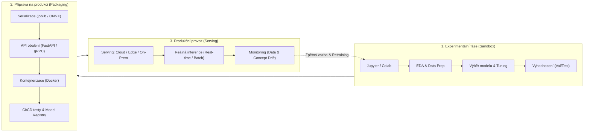
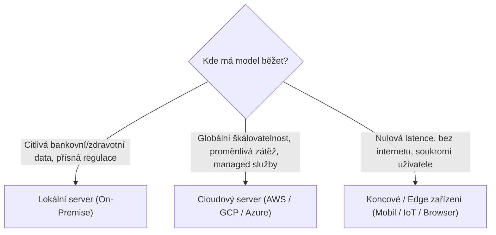
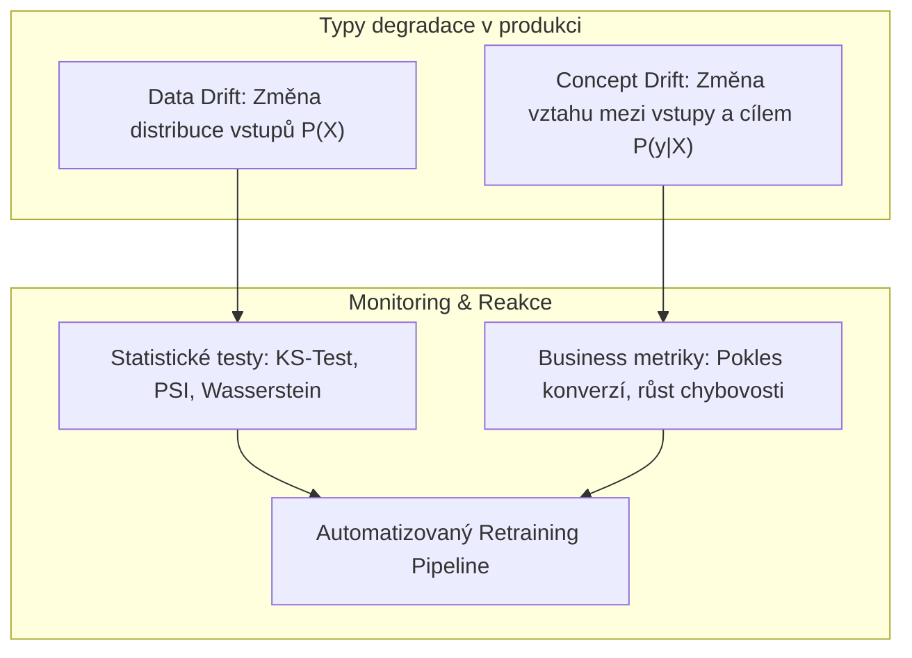

# Produkční nasazení modelů strojového učení (MLOps & Deployment)

Tento dokument zpracovává problematiku **převodu natrénovaného modelu z experimentálního prostředí (Jupyter/Colab) do reálného produkčního provozu**. Vychází ze studijních materiálů kurzu a moderních standardů MLOps pro rok 2026.

---

## 🏭 1. Co je to deployment v Machine Learningu?

Většina datových projektů začíná v Jupyter Noteboocích, kde data scientist čistí data, testuje algoritmy a ladí hyperparametry. Nicméně:

> **Model má reálnou byznysovou hodnotu pouze tehdy, když generuje predikce pro reálné uživatele nebo downstream aplikace v produkci.**



---

## 📍 2. Strategie nasazení podle lokace (Site-Dependent Deployments)

Kam fyzicky model umístíme? Volba architektury závisí na bezpečnosti, latenci, rozpočtu a škálovatelnosti.



### A. Lokální server (On-Premise Deployment)
Model běží na fyzických serverech či v privátním datovém centru společnosti.

- **Kdy zvolit**:
  - Přísné regulační požadavky (GDPR, HIPAA, bankovní tajemství, utajovaná vládní data).
  - Firma již vlastní nevyužité datacentrum a nechce platit cloudové poplatky.
- **Výhody**:
  - Úplná kontrola nad infrastrukturou, daty a bezpečností.
  - Data nikdy neopouštějí interní síť společnosti.
- **Nevýhody & Rizika**:
  - **Vysoké počáteční kapitálové výdaje (CapEx)** na nákup serverů, GPU a chlazení.
  - **Omezená škálovatelnost**: Pokud náhle vzroste poptávka, servery nelze okamžitě navýšit.
  - Nutnost dedikovaného týmu sysadminů / DevOps pro údržbu hardwaru a zálohování.

---

### B. Cloudový server (Cloud Deployment)
Model je nasazen v prostředí velkých poskytovatelů (AWS, Google Cloud Platform, Microsoft Azure). Využívá virtuální servery (EC2, GCE), kontejnery (Kubernetes, ECS, Cloud Run) nebo managed ML platformy (SageMaker, Vertex AI, Azure ML).

- **Kdy zvolit**:
  - Dynamicky kolísající návštěvnost vyžadující automatické škálování (Auto-scaling).
  - Rychlý time-to-market bez nutnosti starat se o hardware.
  - Globální dostupnost pro uživatele z celého světa.
- **Výhody**:
  - **Elasticita**: Systém automaticky přidává výpočetní instance v době špičky a vypíná je v noci.
  - **Vysoká dostupnost (SLA > 99.9%)**: Automatická redundance napříč geografickými zónami.
  - Bohatý ekosystém managed služeb pro monitoring, logování a CI/CD.
- **Nevýhody & Rizika**:
  - **Vendor Lock-in**: Závislost na specifických API a nástrojích jednoho poskytovatele.
  - **Průběžné provozní náklady (OpEx)**: Při špatné konfiguraci nebo zapomenutých GPU instancích mohou náklady nekontrolovaně eskalovat.
  - Latence závislá na kvalitě internetového připojení klienta.

---

### C. Koncové zařízení (Edge & On-Device Deployment)
Model běží přímo na zařízení koncového uživatele – smartphone (iOS CoreML, Android NNAPI), chytré hodinky, Raspberry Pi, průmyslové senzory (IoT), nebo v internetovém prohlížeči (ONNX.js, TensorFlow.js).

- **Kdy zvolit**:
  - Aplikace musí fungovat offline (v letadle, pod zemí, v odlehlých oblastech).
  - Extrémně nízká latence (reálný čas v řádu jednotek milisekund – např. autonomní řízení, FaceID, filtry kamery).
  - Maximální soukromí (obraz z kamery nebo biometrie nikdy neopouští telefon).
- **Výhody**:
  - **Nulové náklady na serverové výpočty**: Výpočetní výkon hradí hardware koncového uživatele.
  - Okamžitá odezva bez síťové latence.
- **Nevýhody & Rizika**:
  - **Hardwarová omezení**: Limitovaná RAM, slabší CPU/GPU, riziko přehřívání a vybíjení baterie.
  - Nutnost komprese modelů: Kvantizace (např. FP32 $\rightarrow$ INT8), prořezávání (Pruning), destilace znalostí (Knowledge Distillation).
  - **Komplikovaná aktualizace**: Nasazení nové verze modelu vyžaduje aktualizaci aplikace v App Store / Google Play, kterou uživatel nemusí provést.

---

## ⚡ 3. Strategie nasazení podle povahy aplikace (Nature of Application)

Jak a kdy se počítají predikce?

| Vlastnost | Real-Time (Online) Inference | Batch (Dávková) Inference | Streaming Inference |
| :--- | :--- | :--- | :--- |
| **Princip** | Predikce na vyžádání (Request-Response) | Pravidelný hromadný přepočet celé databáze | Kontinuální zpracování toku událostí |
| **Latence** | Milisekundy (< 50–200 ms) | Minuty až hodiny | Stovky milisekund až sekundy |
| **Typická technologie** | FastAPI, Flask, Triton, TorchServe | Airflow, Cron, Spark, Ray, dbt | Kafka, Flink, Spark Streaming |
| **Vhodné případy** | Ocenění nemovitosti na webu, fraud detection u platby, live chatbot | Noční generování doporučení práce, měsíční scoring churnu, risk scoring | Detekce kyberútoků v síti, burzovní algoritmické obchodování |
| **Cena výpočtu** | Vyšší (server musí běžet a čekat na požadavky) | Nižší (výpočetní stroje se nastartují jen na dobu dávky) | Střední až vyšší |

---

## 🔄 4. MLOps: Životní cyklus a monitoring po nasazení

Trénováním modelu práce datového vědce nekončí. V produkci nastává jev zvaný **Model Degradation (stárnutí modelu)**.



### Data Drift vs. Concept Drift
1. **Data Drift (Covariate Shift)**:
   - Změnila se distribuce vstupních dat $P(X)$, ale fundamentální vztah $P(y|X)$ zůstal stejný.
   - *Příklad*: Model byl trénován na demografii mladých uživatelů (věk 18–25), ale marketingová kampaň přivedla seniory (věk 60+).
   - *Detekce*: Population Stability Index (PSI), Kolmogorov-Smirnov test, Wasserstein distance.
2. **Concept Drift**:
   - Změnil se skutečný vztah mezi vstupy a cílem $P(y|X)$, často v důsledku externích událostí.
   - *Příklad*: Model predikce prodeje letenek z roku 2019 selhal v březnu 2020 s příchodem pandemie COVID-19. Chování zákazníků se radikálně změnilo.
   - *Řešení*: Přenastavení vah, převážení historických dat, dotrénování na čerstvých datech.

---

## 🛠️ 5. Praktický kód: Jak zabalit Scikit-learn model pro produkci

### Krok 1: Serializace modelu (`joblib`)
```python
import joblib
from sklearn.pipeline import Pipeline
from sklearn.preprocessing import StandardScaler
from sklearn.ensemble import RandomForestClassifier

# Sestavení robustní pipeline (Scaler + Model zaručí ochranu před leakagem)
pipeline = Pipeline([
    ('scaler', StandardScaler()),
    ('model', RandomForestClassifier(n_estimators=100, random_state=42))
])
pipeline.fit(X_train, y_train)

# Uložení kompletní pipeline
joblib.dump(pipeline, 'production_model.joblib', compress=3)
```

### Krok 2: Vytvoření REST API pomocí FastAPI
```python
from fastapi import FastAPI, HTTPException
from pydantic import BaseModel
import joblib
import numpy as np

app = FastAPI(title="ML Prediction Service", version="1.0.0")

# Načtení modelu do paměti při startu serveru
model = joblib.load('production_model.joblib')

class PredictionInput(BaseModel):
    feature1: float
    feature2: float
    feature3: float

@app.post("/predict")
def predict(payload: PredictionInput):
    try:
        data = np.array([[payload.feature1, payload.feature2, payload.feature3]])
        prediction = model.predict(data)[0]
        probability = model.predict_proba(data)[0].tolist()
        return {
            "prediction": int(prediction),
            "probabilities": probability,
            "status": "success"
        }
    except Exception as e:
        raise HTTPException(status_code=500, detail=str(e))
```
