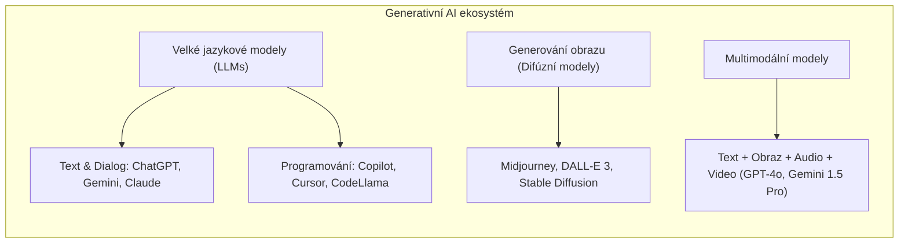
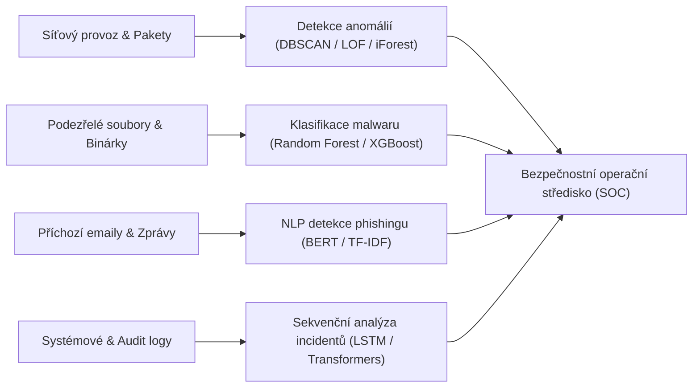

# Kam dál? Průvodce dalším rozvojem, AI trendy a Generativní AI

Dokončením základního kurzu Data Science & Machine Learning vaše cesta světem umělé inteligence teprve začíná. Oblast AI a strojového učení se vyvíjí bezprecedentní rychlostí a klíčovou kompetencí moderního datového vědce je schopnost neustále vstřebávat nové poznatky a orientovat se v nejnovějších trendech.

Tento dokument shrnuje **doporučené studijní zdroje, komunity, současné technologické trendy (Generativní AI, LLMs) a uplatnění AI v kyberbezpečnosti**.

---

## 📚 1. Kde čerpat znalosti a prohlubovat kompetence?

### 📖 Doporučená odborná literatura
1. **Aurélien Géron: *Hands-On Machine Learning with Scikit-Learn, Keras & TensorFlow*** (O'Reilly)
   - Absolutní „bible“ aplikovaného strojového učení. Vynikající přechod od klasických tabulárních modelů k hlubokému učení v Pythonu.
2. **Laurence Moroney: *AI and Machine Learning for Coders*** (O'Reilly)
   - Skvělá kniha pro vývojáře bez hlubokého matematického zázemí, zaměřená na praktickou implementaci.
3. **John Hearty: *Advanced Machine Learning with Python*** (Packt)
   - Pokročilé techniky zpracování obrazu, zvuku, textu a finančních časových řad.
4. **Ian Goodfellow, Yoshua Bengio, Aaron Courville: *Deep Learning*** (MIT Press)
   - Teoretický základ matematických principů hlubokého učení (lineární algebra, teorie pravděpodobnosti, informační teorie).

---

### 🌐 Komunity a diskusní platformy
- **Kaggle (kaggle.com)**:
  - Jedinečná platforma pro data scientisty. Obsahuje tisíce reálných datasetů, veřejné notebooky (Kernely), aktivní diskusní fóra a soutěže se štědrým finančním ohodnocením. Nejlepší způsob, jak vidět kód špičkových světových expertů (Grandmasterů).
- **Stack Overflow & Cross Validated (stats.stackexchange.com)**:
  - Pro řešení programátorských záseků v Pythonu slouží Stack Overflow. Pro matematické otázky, volbu statistických testů a teoretické nuance algoritmů je nepostradatelný *Cross Validated*.
- **Reddit**:
  - Subreddity jako `r/MachineLearning`, `r/datascience`, `r/LocalLLaMA` přinášejí každodenní diskuse o nejnovějších vědeckých článcích, knihovnách a hardwaru.
- **GitHub**:
  - Sledování a zkoumání kódu populárních open-source repozitářů (`scikit-learn`, `xgboost`, `huggingface/transformers`, `vllm`, `langchain`).

---

### 📺 YouTube kanály a online přednášky
- **StatQuest with Josh Starmer**:
  - Nenapodobitelně srozumitelné, vizuální vysvětlení matematiky za algoritmy (od lineární regrese přes PCA až po Transformers a Attention mechanismus). *BAM!*
- **Andrej Karpathy**:
  - Bývalý ředitel AI v Tesle a spoluzakladatel OpenAI. Jeho série videí *Neural Networks: Zero to Hero* (od vytvoření mikrogradu a backpropagation v čistém Pythonu až po natrénování GPT od nuly) patří k nejlepším vzdělávacím materiálům v historii počítačových věd.
- **Sentdex (Harrison Kinsley)**:
  - Praktické tutoriály v Pythonu pokrývající ML, robotiku, finance a reinforcement learning.
- **3Blue1Brown (Grant Sanderson)**:
  - Fascinující animované vizualizace lineární algebry, matematické analýzy a principů neuronových sítí.

---

## 🚀 2. Současné trendy v AI: Generativní AI & LLMs

Zatímco klasický machine learning řeší převážně predikci diskrétní třídy nebo spojitého čísla na základě existujících dat, **Generativní AI (GenAI)** vytváří zcela nový obsah (text, kód, obraz, zvuk, video).

### Velké jazykové modely (LLMs)
- Jsou postaveny na architektuře **Transformer** (Decoder-only u GPT/LLaMA/Claude, Encoder-Decoder u T5) a trénovány na bilionech tokenů z celého internetu (Common Crawl, Wikipedia, knihy, kód).
- **OpenAI (ChatGPT / GPT-4o)**: Průkopník spotřebitelské AI s pokročilou analýzou dat (Advanced Data Analysis – spouštění Python kódu přímo v chatu).
- **Google (Gemini)**: Multimodální od základu, obrovské kontextové okno (až 2 miliony tokenů).
- **Meta (LLaMA)**: Open-weight modely, které umožňují firmám a výzkumníkům provozovat špičková LLM na vlastním hardwaru bez rizika úniku dat do cloudu.

### Zásadní limity a rizika LLM, na které musí datový vědec pamatovat:
1. **Halucinace (Confabulation)**: Model dokáže s absolutní jistotou tvrdit naprosté faktické nepravdy. LLM je pravděpodobnostní generátor následujícího slova, nikoliv databáze faktů.
2. **Nedeterminismus**: Stejný dotaz může při vyšší teplotě (`temperature > 0`) vygenerovat pokaždé jinou odpověď.
3. **Časový cutoff znalostí**: Modely nejsou trénovány v reálném čase. Pro aktuální data vyžadují architektury **RAG (Retrieval-Augmented Generation)** s vektorovými databázemi (ChromaDB, Pinecone, Qdrant).
4. **Zranitelnosti a bezpečnost**: Možnost zneužití pro generování spamu, phishingových kampaní nebo útoky typu **Prompt Injection**.

---

## 🛡️ 3. Aplikace Machine Learningu v kyberbezpečnosti

Jednou z nejrychleji rostoucích domén aplikace ML je **ochrana před kybernetickými hrozbami**.

1. **Detekce anomálií v síťovém provozu**:
   - Tradiční firewally kontrolují pravidla. ML modely monitorují reálný tok paketů a okamžitě hlásí nestandardní aktivitu (neobvyklé porty, komunikace s neznámými IP adresami, noční objemy přenesených dat indikující únik dat – Data Exfiltration).
2. **Detekce nového malwaru (Zero-Day Exploits)**:
   - Tradiční antiviry hledají známé hashe/podpisy. Pokud útočník kód mírně změní (polymorfní malware), podpis selže. ML analyzuje chování programu (API volání, přístup k registrům) a rozpozná infikovaný soubor na základě vzorců.
3. **NLP pro boj s phishingem**:
   - Analýza textu emailu, hlaviček a domén. Moderní modely dokáží detekovat manipulativní jazyk, nátlak na okamžitou akci a podvržené URL adresy.
4. **Analýza bezpečnostních logů (SIEM)**:
   - Zpracování milionů řádků logů z firemních systémů v reálném čase. Detekce pokusů o prolomení hesel (brute-force) nebo neoprávněného přesunu interních souborů zaměstnanci.

### Výzva: False Positives vs. False Negatives v bezpečnosti
- **False Negative (Falešně negativní)**: Útok proběhl, ale model ho označil za bezpečný traffic $\rightarrow$ **Kritické bezpečnostní selhání** (napadení sítě).
- **False Positive (Falešně pozitivní)**: Běžný uživatel provedl legitimní operaci, ale model spustil poplach $\rightarrow$ Vede k **únavě operátorů z poplachů (Alert Fatigue)** a zahlcení bezpečnostního týmu.
- **Závěr**: Modely v bezpečnosti se ladí na **extrémně vysoký Recall** s pečlivou kalibrací prahu spolehlivosti.
