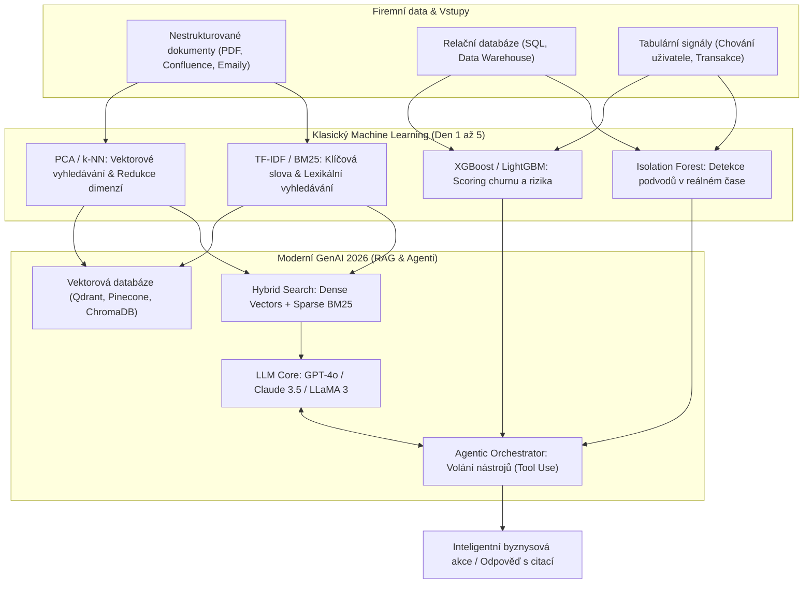
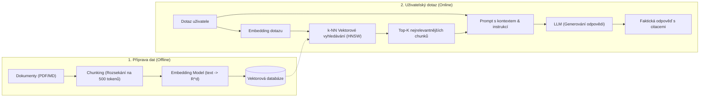
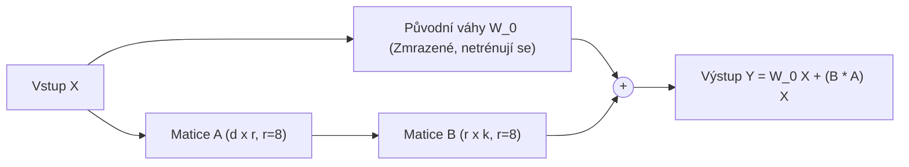
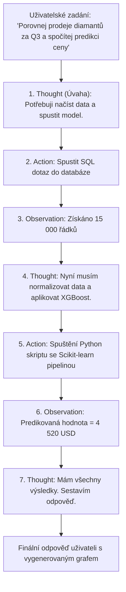

# Moderní Machine Learning v roce 2026: RAG, LoRA, AI Agenti & XAI

Tento dokument představuje **most mezi základy strojového učení (absolvovanými v kurzu) a moderní praxí v roce 2026**. Ukazuje, jak se koncepty ze Dne 2 (k-NN), Dne 4 (embeddingy, TF-IDF, Transformers) a Dne 5 (nízkorozměrné matice, PCA) staly základními kameny současných architektur generativní umělé inteligence.

---

## 🌐 1. Velká fúze: Klasický ML + Generativní AI

V roce 2026 se datová věda nedělí na „klasické tabulární modely“ a „LLM chatboti“. Špičkové produkční systémy fungují jako **hybridní architektury**:

---

## 🔍 2. RAG (Retrieval-Augmented Generation) do hloubky

Základní problém velkých jazykových modelů (LLM) je dvojí:
1. **Halucinace**: Model mluví plynule a přesvědčivě i tehdy, když si fakta vymýšlí.
2. **Neznalost privátních a čerstvých dat**: Model byl dotrénován k určitému datu a nemá přístup k interním firemním směrnicím, smlouvám či databázím.

### Architektura RAG Pipeline:

### Proč RAG navazuje na náš kurz?
- **Embeddingy (Den 4)**: Text převádíme na dense vektor $\mathbf{v} \in \mathbb{R}^{d}$ (obvykle $d=1536$ nebo $3072$). Sémanticky podobné myšlenky mají vysokou kosínovou podobnost:
  $$\text{Cosine Similarity}(\mathbf{u}, \mathbf{v}) = \frac{\mathbf{u} \cdot \mathbf{v}}{\|\mathbf{u}\| \|\mathbf{v}\|}$$
- **k-Nejbližších sousedů (Den 2)**: Ve vektorové databázi hledáme $k$ nejbližších chunků k vektoru dotazu. Místo pomalého přesného k-NN ($O(N)$) se používá algoritmus **HNSW (Hierarchical Navigable Small World)** pro bleskové přibližné vyhledávání (ANN) v milisekundách.

### Pokročilé RAG techniky v roce 2026:
1. **Hybrid Search (Dense + Sparse)**:
   - *Problém čistého vektorového vyhledávání*: Špatně hledá přesná čísla smluv, produktové kódy či specifická jména.
   - *Řešení*: Kombinace sémantických embeddingů s algoritmem **BM25 / TF-IDF** (ze Dne 4). Vynikající syntéza porozumění významu + přesné shody klíčových slov.
2. **Re-ranking (Cross-Encoder)**:
   - Vektorová databáze vrátí hrubých top 20 chunků.
   - Specializovaný menší model (**Cross-Encoder Re-ranker**) přesně porovná každý pár (dotaz, dokument) a vybere finálních 3–5 nejlepších chunků pro LLM.
3. **GraphRAG**:
   - Spojení vektorů se znalostním grafem (**Knowledge Graph** – entity a vztahy: *Kdo je jednatelem dodavatele X?*). Odstraňuje slepá místa běžného chunkingu.

---

## ⚡ 3. PEFT & LoRA: Parameter-Efficient Fine-Tuning

Co když potřebujeme model naučit specifický odborný žargon, styl komunikace nebo složitý JSON formát, kde RAG nestačí? Plný Fine-Tuning 70B modelu vyžaduje desítky grafických karet A100/H100.

Řešením roku 2026 je **LoRA (Low-Rank Adaptation)**.

### Matematický princip (Spojení s PCA ze Dne 5):
Vzpomeňte si na PCA ze Dne 5: data leží ve vysoké dimenzi, ale jejich podstatná variabilita se dá popsat několika málo hlavními komponentami (nízká efektivní dimenze / Intrinsic Dimension).

LoRA předpokládá totéž pro změnu vah neuronové sítě $\Delta W$:
$$\Delta W = B \times A, \quad \text{kde } B \in \mathbb{R}^{d \times r}, \; A \in \mathbb{R}^{r \times k}, \; r \ll \min(d, k)$$
- Pro $d = 4096$ a rank $r = 8$:
  - Místo $4096 \times 4096 \approx 16\,777\,216$ parametrů trénujeme pouze $2 \times 4096 \times 8 = 65\,536$ parametrů!
  - **Snížení paměťových a výpočetních nároků o více než 99 %!**
- **QLoRA**: Kvantizuje původní model do 4 bitů (NF4 – NormalFloat4) a trénuje LoRA adaptéry v 16 bitech. Umožňuje jemně doladit 70B model na jediné běžné pracovní stanici.

---

## 🤖 4. Agentic AI & Vzor ReAct (Reason + Act)

Tradiční ML model provede pasivní výpočet. **AI Agent** je autonomní systém, kde LLM slouží jako rozhodovací kognitivní jádro schopné používat externí nástroje.

### Proč jsou agenti budoucností datové vědy?
- Agent dokáže **dynamicky kombinovat dříve naučené modely**:
  - Když narazí na text $\rightarrow$ zavolá NLP embedding.
  - Když narazí na odlehlé hodnoty $\rightarrow$ zavolá Isolation Forest.
  - Když potřebuje predikci spojitého čísla $\rightarrow$ zavolá natrénovaný regresní model.
- Právě tato orchestrace je podstatou pokročilého agentního programování.

---

## 🔬 5. Explainable AI (XAI) & SHAP hodnoty

V roce 2026 ukládá legislativa (**EU AI Act**) přísné požadavky na transparentnost algoritmů. Nasadit model bez vysvětlitelnosti (např. při zamítnutí úvěru v bance nebo v lékařské triáži) je nelegální.

### SHAP (Shapley Additive exPlanations):
Vychází z teorie kooperativních her (Nobelova cena za ekonomii, Lloyd Shapley).

Pro každé jednotlivé pozorování rozkládá predikci na součet základní hodnoty (Base Value – průměr populace) a příspěvků jednotlivých proměnných:
$$\hat{y}(x) = \phi_0 + \sum_{j=1}^{p} \phi_j(x)$$
- $\phi_0$: Průměrná predikce modelu napříč celým trénovacím datasetem (např. základní cena domu 350 000 USD).
- $\phi_1 = +85\,000$: Příspěvek lokality (výborná prestižní čtvrť).
- $\phi_2 = -30\,000$: Příspěvek stáří domu (rok stavby 1965).
- $\phi_3 = +45\,000$: Příspěvek podlahové plochy ($250\,\text{m}^2$).
- **Výsledek**: Klient i regulátor přesně vidí, které proměnné predikci zvýšily a které snížily.

---

## 🧭 6. Rozhodovací matice 2026: Prompting vs. RAG vs. Fine-Tuning

| Kritérium | Prompt Engineering | RAG (Retrieval-Augmented) | Fine-Tuning (LoRA / QLoRA) |
| :--- | :--- | :--- | :--- |
| **Přístup k privátním datům** | Pouze malé množství v promptu | **Neomezený (Dynamická Vector DB)** | Pouze data známá v době trénování |
| **Frekvence aktualizace dat** | Okamžitá (stačí vložit text) | **Reálný čas (Zápis do Vector DB)** | Pomalá (vyžaduje nový trénovací cyklus) |
| **Prevence halucinací** | Nízká | **Maximální (Citace konkrétních zdrojů)** | Střední (model stále může halucinovat) |
| **Změna stylu / tónu / JSON formátu** | Střední | Nízká (přidává pouze fakta) | **Špičková (Přeučení distribučních vah)** |
| **Výpočetní & Finanční náročnost** | Nulová (pouze API volání) | Nízká až střední (provoz Vector DB) | Střední (vyžaduje GPU pro trénování) |
| **Typický use-case** | Rychlé prototypy, obecné dotazy | Firemní vyhledávače, manuály, podpora | Lékařská diagnostika, právní specializace |
